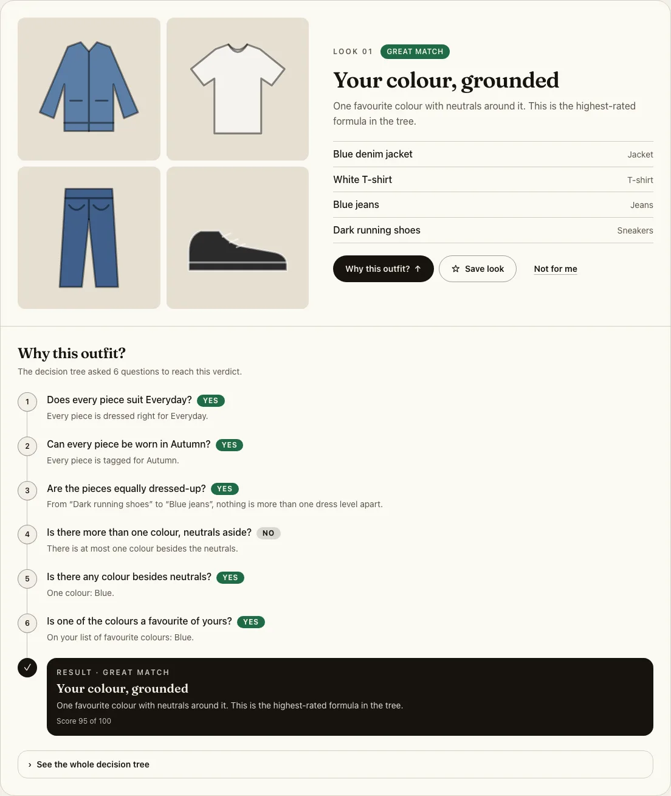
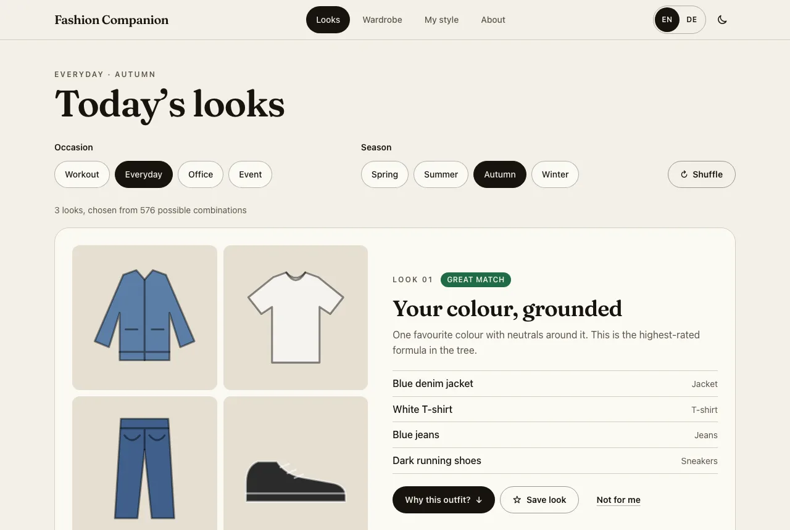
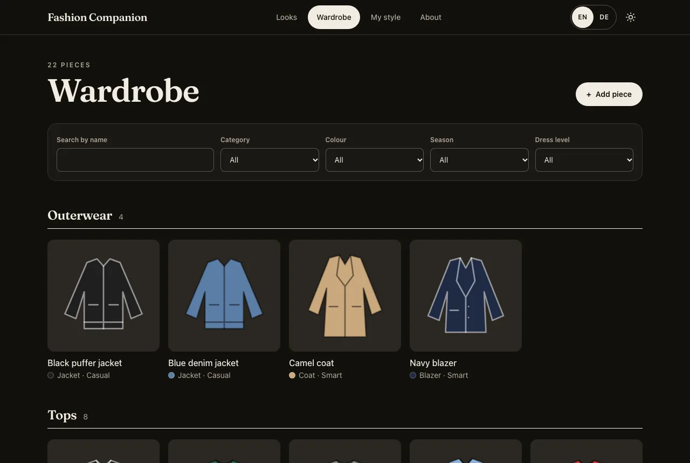
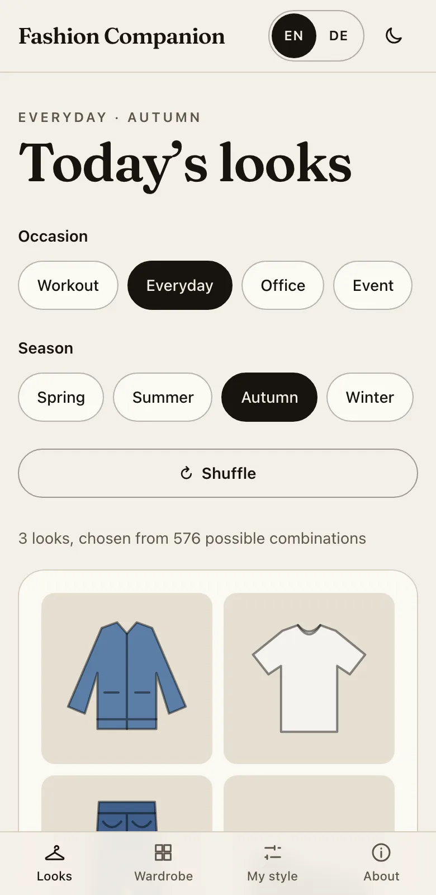

# Fashion Companion

A closet manager that suggests outfits and shows the exact rules behind every suggestion. It runs entirely in the browser.

**Live demo:** <https://ngnmsv.github.io/fashion-companion/>



How it works is in [ARCHITECTURE.md](ARCHITECTURE.md).

## Features

- **Outfits for an occasion and a season.** Every combination of your available pieces is judged by a decision tree; the best three are shown.
- **"Why this outfit?"** Each look lists the questions the tree asked, the answer to each, and the verdict. You can open the whole tree with the taken path highlighted.
- **Wardrobe.** A grid grouped by category, with search and filters for category, colour, season and dress level. Add, edit and delete pieces in one dialog.
- **Your own photos.** Optional, scaled down and stored in the browser only. The colour is read from the photo.
- **Onboarding in three questions,** or one click on "Try with sample wardrobe" to load 22 sample pieces.
- **Save looks, or remove them** with "Not for me" (with Undo).
- **English and German,** light and dark theme.
- **No account, no server, no tracking.** Data lives in IndexedDB on your device.

| Looks                                             | Wardrobe (dark theme)                                   | Phone                                            |
| ------------------------------------------------- | ------------------------------------------------------- | ------------------------------------------------ |
|  |  |  |

## Tech stack

| Area      | Choice                                                        |
| --------- | ------------------------------------------------------------- |
| UI        | React 19, TypeScript (strict, no `any`), Tailwind CSS 4       |
| Build     | Vite                                                          |
| Data      | IndexedDB behind a repository interface, read through TanStack Query |
| Logic     | A pure TypeScript decision-tree module (`src/engine/`)        |
| Tests     | Vitest, React Testing Library, Playwright                     |
| Delivery  | GitHub Actions → GitHub Pages                                 |

Runtime dependencies: `react`, `react-dom`, `@tanstack/react-query`. The router, the i18n layer and the IndexedDB wrapper are written by hand. The one web font (Fraunces, Latin subset) is self-hosted.

## Run it

You need Node.js 22 or newer.

```bash
npm install
npm run dev
```

Open <http://localhost:5173/fashion-companion/>.

To see the production build:

```bash
npm run build
npm run preview   # http://localhost:4174/fashion-companion/
```

## Test it

| Command             | What it does                                                     |
| ------------------- | ---------------------------------------------------------------- |
| `npm run test`      | 164 unit and component tests (Vitest, React Testing Library)     |
| `npm run e2e`       | 8 end-to-end scenarios on desktop and phone size (Playwright); run `npm run build` first |
| `npm run lint`      | ESLint                                                           |
| `npm run typecheck` | TypeScript                                                       |
| `npm run check`     | All of the above plus the build, in the order CI runs them       |

The first time, install the browser for the end-to-end tests: `npx playwright install chromium`.

What the tests cover:

- **The decision tree:** every one of its 14 leaves is reached by a test; the recorded explanation is replayed against the tree; occasion, season and colour rules each have edge cases.
- **Recommending:** empty and incomplete wardrobes, unavailable pieces, removed looks, ranking, variety, limits, determinism, outerwear, and all 16 occasion × season combinations of the sample wardrobe.
- **Components:** onboarding, outfit cards, the Why panel, saving and removing, wardrobe filters, add/edit/delete, language and theme.
- **End to end:** set preferences → add pieces → get an explained outfit; data survives a reload; deep links; keyboard-only use; no sideways scrolling.

## Quality

Lighthouse, mobile, on the production build:

| Performance | Accessibility | Best Practices | SEO |
| ----------- | ------------- | -------------- | --- |
| 99          | 100           | 100            | 100 |

Measured on the production build served locally (`npm run preview`).

## Change the rules

The styling rules live in `src/engine/tree.ts`: the tree itself (`TREE`), the logic of each question (`TESTS`), and the numbers behind them (`OCCASION_RULES`, `MIN_CONTRAST`, …). The texts for each question and verdict are in `src/i18n/en.ts` and `de.ts`. Run `npm run test` afterwards; one test fails if a leaf can no longer be reached.

## Deploy

Every push to `main` runs lint, typecheck, tests, build and end-to-end tests, then publishes to GitHub Pages. One-time setup in the repository: **Settings → Pages → Source: GitHub Actions**.

The app is served from a sub-path, so `base` in `vite.config.ts` must match the repository name (`/fashion-companion/`).
